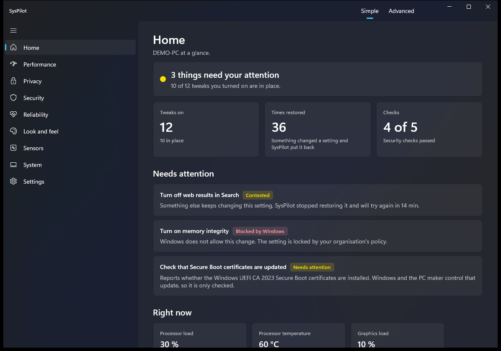
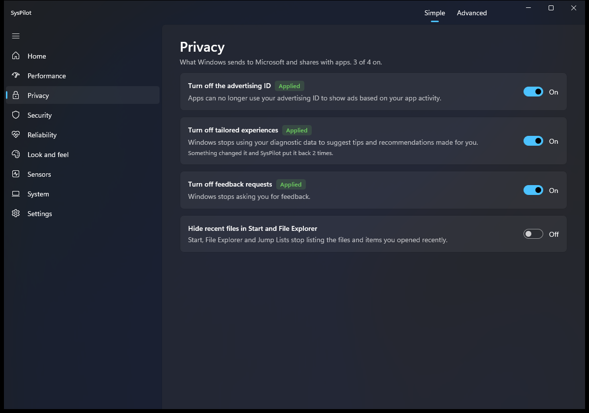
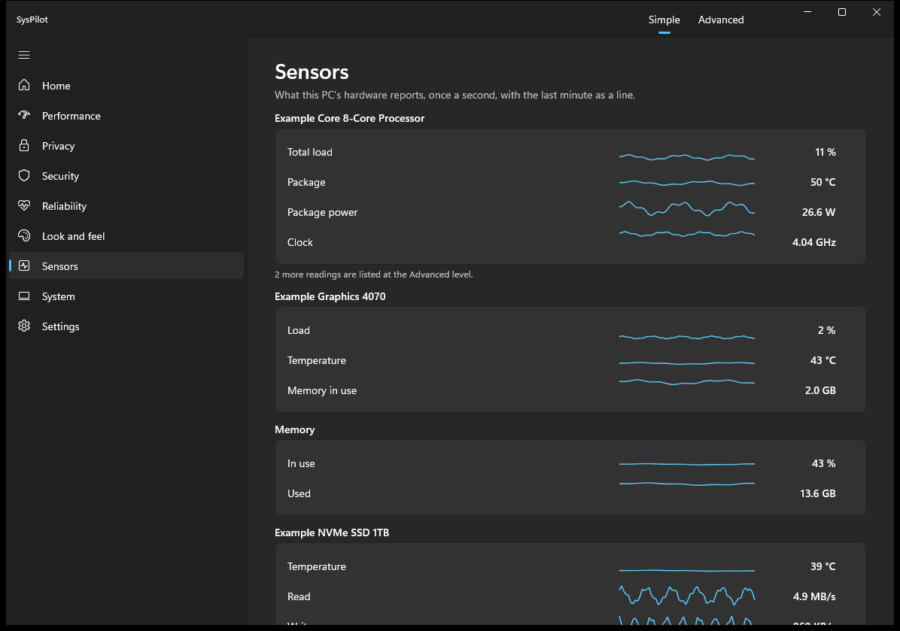
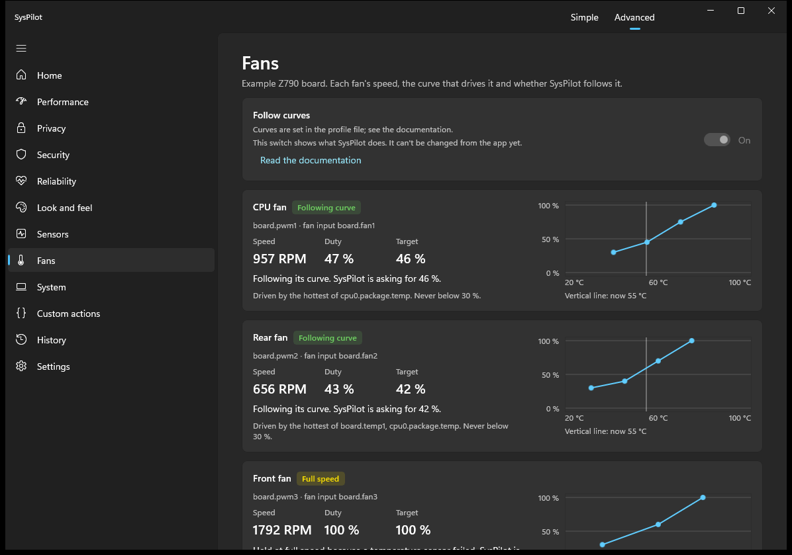
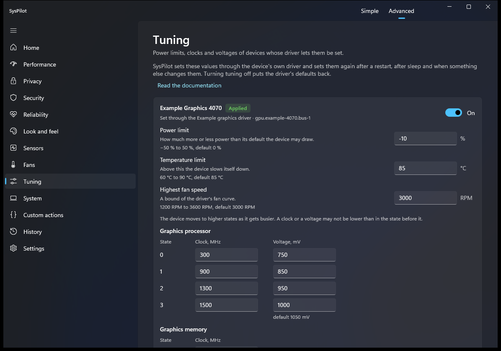

# SysPilot

SysPilot keeps a Windows PC the way you set it up. You choose privacy, security
and performance settings from a catalog where every entry cites Microsoft's own
documentation; a small service applies them, notices when an update or another
program changes one back, and restores it. Turning a setting off puts back
exactly what was there before.

It also reads the machine's sensors (temperatures, loads, fan speeds) with close
to no cost when nobody is looking.



> **Status: [0.2.2](https://github.com/juliopolycarpo/syspilot/releases/tag/v0.2.2).**
> The service, the catalog, the sensors, the app, the command line and the
> installer work and are tested end to end, and an installed copy keeps itself
> up to date. The package carries no Authenticode certificate, so Windows may
> warn on first run; see [verifying a download](#verifying-a-download).
> Hardware sensors have been checked on one machine so far
> ([what was found](docs/research/reference-machine.md)); expect gaps on
> others and please report them. See [the roadmap](#roadmap).

## What makes it different

- **Settings stay set.** Each setting is watched with a registry notification,
  so a change is noticed and undone within milliseconds, without polling.
- **Everything is reversible.** Before SysPilot writes anything it records what
  was there, including "nothing". Turning a tweak off, or uninstalling, restores
  that exactly.
- **It does not fight.** If something else keeps rewriting a value, SysPilot
  stops after a few rounds, reports the setting as *contested* and retries with
  a growing delay instead of burning CPU in a tug of war.
- **It tells the truth about Windows.** A setting Windows protects is reported
  as not enforceable. SysPilot never takes ownership of keys or bypasses
  protections to force a value.
- **Sourced catalog.** Every built-in tweak names the Microsoft page that
  documents the value it writes. Entries that weaken security say so and state
  the risk.
- **Nearly free when idle.** One event-driven process, no timers when nothing
  is contested and no client is connected, and a few megabytes of memory.

## Requirements

- Windows 10 or 11, x64.
- Administrator rights to install the service and to change settings.
- Optional: the [PawnIO](https://pawnio.eu/) driver for sensors that need
  hardware access (CPU, chipset and memory temperatures, fan speeds). SysPilot
  does not ship or install the driver. Without it everything else works and the
  features that need it are shown as unavailable.

## Installing

Download `SysPilot-<version>-x64.msi` from the
[latest release](https://github.com/juliopolycarpo/syspilot/releases/latest)
and open it. It puts the files in `Program Files\SysPilot`, registers and
starts the service and adds SysPilot to the Start menu and to Installed apps.
Without any window:

```console
> msiexec /i SysPilot-0.2.0-x64.msi /qn
```

Installing a newer package over an older one updates in place and keeps your
settings; that includes a 0.1 installed by its script.

Uninstalling, from Installed apps or with `msiexec /x`, first restores every
setting SysPilot changed, then removes the service, the files, the data in
`ProgramData\SysPilot` and each user's app preferences. Nothing of SysPilot
stays behind. To leave the settings as SysPilot set them, uninstall with
`msiexec /x SysPilot-0.2.0-x64.msi KEEPTWEAKS=1`.

### Updates

The service looks for a new release once a day. What it does then is yours to
choose, under Settings in the app or with `syspilot-svc updates <mode>`:

| Mode        | What happens                                                        |
| ----------- | ------------------------------------------------------------------- |
| `notify`    | The default. The app says that a new version is there; you install it with one click (or `syspilot-svc update`). |
| `automatic` | A new version is installed by itself, without a prompt, while the app is closed. |
| `off`       | SysPilot never looks and never mentions a new version.               |

An update is only ever installed if the package carries a signature made with
the project's release key, which is not stored on GitHub. How that holds up is
in the [security model](docs/security-model.md#updates).

### Verifying a download

Every package comes with that signature, `SysPilot-<version>-x64.msi.sig`.
With the OpenSSH that is part of Windows, and the key list from this
repository ([`installer/update-signers`](installer/update-signers)):

```console
> cmd /c "ssh-keygen -Y verify -f update-signers -I syspilot -n syspilot-update -s SysPilot-0.2.0-x64.msi.sig < SysPilot-0.2.0-x64.msi"
Good "syspilot-update" signature for syspilot with ED25519 key SHA256:...
```

The packages carry no Authenticode certificate yet, so SmartScreen may say the
publisher is unknown. Every release is built from a signed tag in this
repository, so you can also build it yourself (see [Building](#building)).

## The app

Two levels. **Simple** lists the settings that are safe for anyone and says
what each one does in a sentence. **Advanced** adds the rest of the catalog,
the exact values behind every switch, your own actions, the history and every
sensor.

| | |
| --- | --- |
|  |  |

A setting that weakens protection asks first and states the risk. A setting
Windows refuses is shown as *Blocked by Windows*, with the reason. Changing
anything needs an administrator; without one the app shows everything and
offers to restart elevated.

The Advanced level also has a Fans page: each fan's speed and duty, its curve
and whether SysPilot follows it. Releases only show fans; following curves
waits for a board to be validated (see [fan curves](docs/fan-curves.md)).



And a Tuning page, for devices whose own driver lets their power limit,
clocks and voltages be set: today AMD Radeon RX 400 and RX 500 cards. SysPilot
sets your values again after a restart or sleep, asks before a clock or a
voltage takes effect, and does not set them again by itself after Windows
stopped (see [tuning](docs/tuning.md)).



`syspilot --demo` runs the app on made-up data without a service, to look
around without changing anything.

## The command line

Everything the app does, the service's own executable does too. From an
elevated terminal:

```console
> syspilot-svc list
performance.disk-idle-timeout-ac  off                Keep the hard disk on while plugged in
privacy.advertising-id            off (already set)  Turn off the advertising ID
security.audit-secure-boot        ok                 Check that Secure Boot is on
...

> syspilot-svc show privacy.advertising-id
> syspilot-svc enable privacy.advertising-id
> syspilot-svc history
> syspilot-svc updates automatic
> syspilot-svc update --check
```

`syspilot-svc --help` lists every command. The product service only runs from
under `Program Files`; a LocalSystem service whose executable a standard user
could replace would hand that user the machine.

A profile is a TOML file. Besides catalog tweaks it can hold your own actions:
registry values, service start types, power settings and commands.

```toml
schema = 1
enabled = ["privacy.advertising-id", "security.llmnr"]

[[custom]]
id = "custom.keep-my-value"
title = "Keep my value"
action = { registry = { scope = "machine", key = 'SOFTWARE\Example', name = "Value", data = { dword = 1 } } }
```

```console
> syspilot-svc export profile.toml
> syspilot-svc apply profile.toml
```

A profile can also hold a temperature curve per fan channel. Only builds with
the `fan-control` feature accept it, only a board whose catalog entry a person
validated is driven, and no board is yet, so releases and the default build
never write to a fan:

```toml
[[fan]]
channel = "board.pwm2"
sources = ["cpu.package.temp", "gpu0.temp"]
points = [[40, 30], [60, 50], [80, 100]]
```

The fields, the rules and what happens when a sensor fails are in
[fan curves](docs/fan-curves.md).

And the values to hold on a device that can be tuned, described in
[tuning](docs/tuning.md):

```toml
[[tuning]]
device = "gpu.amd-699f.bus-3"

[tuning.values]
power-limit = -10
```

## How it is built

Five programs with a strict split of privilege:

| Part               | Runs as                       | Does                                                  |
| ------------------ | ----------------------------- | ----------------------------------------------------- |
| `syspilot-svc`     | LocalSystem service           | Applies and restores settings. Always running, about 2 MB. |
| `syspilot-sensors` | Started by the service, only while values are wanted | Reads the hardware. Writes to it only in a build with the `fan-control` feature, which releases do not have. |
| `syspilot-update`  | Started by the service, for seconds a day | Finds a new release, verifies its signature and hands it to Windows Installer. |
| `syspilot-tune`    | Started by the service, for a moment when tuning values are looked at or set | Reads and sets a device's tuning values through its vendor's driver. |
| `syspilot` (app)   | The signed-in user            | Shows state and sends requests. Holds no rights.      |

They talk over a local named pipe. Anyone signed in can read the catalog,
states and sensors; only an elevated administrator can change anything or read
the profile. The service decides that from the caller's token, not from what the
client claims.

| Crate              | Purpose                                                       |
| ------------------ | ------------------------------------------------------------- |
| `crates/proto`     | The contract: actions, catalog, profile, messages, client.    |
| `crates/engine`    | Apply, snapshot, revert, drift and contested handling.        |
| `crates/hw`        | Sensor providers, the sampling hub and the tuning backends.   |
| `crates/pawnio`    | Thin wrapper over the PawnIO driver interface.                |
| `crates/sensors`   | The sensor worker.                                            |
| `crates/svc`       | The service, its registration and the command line.           |
| `crates/update`    | The updater.                                                  |
| `crates/tune`      | The tuner.                                                    |
| `installer`        | The Windows Installer package and the release keys.           |
| `crates/ui`        | The desktop app.                                              |
| `catalog/tweaks`   | The built-in tweaks, as data.                                 |

More in [`docs/`](docs/README.md): [architecture](docs/architecture/overview.md),
[enforcement](docs/architecture/enforcement.md),
[protocol](docs/protocol.md), [security model](docs/security-model.md),
[overhead budget](docs/architecture/overhead.md),
[decisions](docs/decisions.md) and the
[catalog authoring guide](docs/tweak-catalog.md).

## Building

Rust (the pinned toolchain installs itself through `rustup`) and the MSVC build
tools are the only requirements. Building the installer also needs the .NET
SDK, for the WiX toolset, which `package.ps1` installs under `target\`.

```console
> cargo build --release
> cargo test --workspace
> cargo xtask fetch-modules
> ./scripts/package.ps1
```

The first build of the app downloads the Windows App SDK runtime it ships
with. `fetch-modules` downloads the PawnIO modules the sensor worker loads,
pinned by SHA-256; they are LGPL-2.1 files kept beside the executables and are
never part of this repository. `package.ps1` leaves the installer,
`SysPilot-<version>-x64.msi`, in `dist\`. A copy installed from a package you
built only updates itself to releases signed with a key in
`installer/update-signers`.

Some tests install a temporary service named `SysPilot-Test` and write scratch
registry keys named `SysPilot-Test`; they need an elevated terminal and remove
everything they create. See [CONTRIBUTING.md](CONTRIBUTING.md).

## Roadmap

- [x] Enforcement engine with exact revert and contested handling
- [x] Service, installer and command line
- [x] Sourced tweak catalog
- [x] Sensor providers (operating system, GPU, storage; CPU, board and chipset through PawnIO)
- [x] Desktop app with Simple and Advanced levels
- [x] Sensor logging to CSV from the app
- [x] Package, install and uninstall scripts
- [x] First release (0.1.0 as a pre-release, 0.1.1 as the first full release)
- [x] A Windows Installer package that removes everything it installed
- [x] Updates: told about by default, automatic or off by choice, accepted only with the release key's signature
- [ ] Authenticode signing, so that Windows names the publisher (waits for a certificate)
- [ ] Sensors verified on more machines (AMD processors, memory modules, more Super I/O chips)
- [x] Fan control core: curve engine, board catalog and fail-safes, compiled out of releases and tested against recordings only ([what must be validated first](docs/research/fan-control.md))
- [x] Fan curves in the service and the app (a Fans page, curves read from the profile), behind the same feature and replay-tested only
- [ ] Fan control validated on a real board, then enabled for that board only
- [ ] A curve editor in the app
- [x] Tuning through the vendor's driver: power limit, clocks and voltages of Radeon RX 400 and RX 500 cards, with a Tuning page
- [ ] Tuning for newer Radeon cards, NVIDIA cards and processors that allow it

## Safety

SysPilot changes system settings. The catalog is conservative and sourced, and
every change is reversible, but you are the one deciding what to enable. Read
the description and the side effects of a tweak before turning it on,
especially in the Advanced level. Tuning is a different kind of change: a
clock or a voltage the driver accepts can still be one your device does not
hold, so start from the defaults and move in small steps
([tuning](docs/tuning.md#if-windows-stops)). Vulnerabilities: see
[SECURITY.md](SECURITY.md).

## License

The service and the app are licensed under [GPL-3.0-or-later](LICENSE). The
reusable libraries (`proto`, `engine`, `pawnio`) are dual-licensed under
[MIT](LICENSE-MIT) or [Apache-2.0](LICENSE-APACHE). Third-party components are
listed in [THIRD-PARTY.md](THIRD-PARTY.md).
